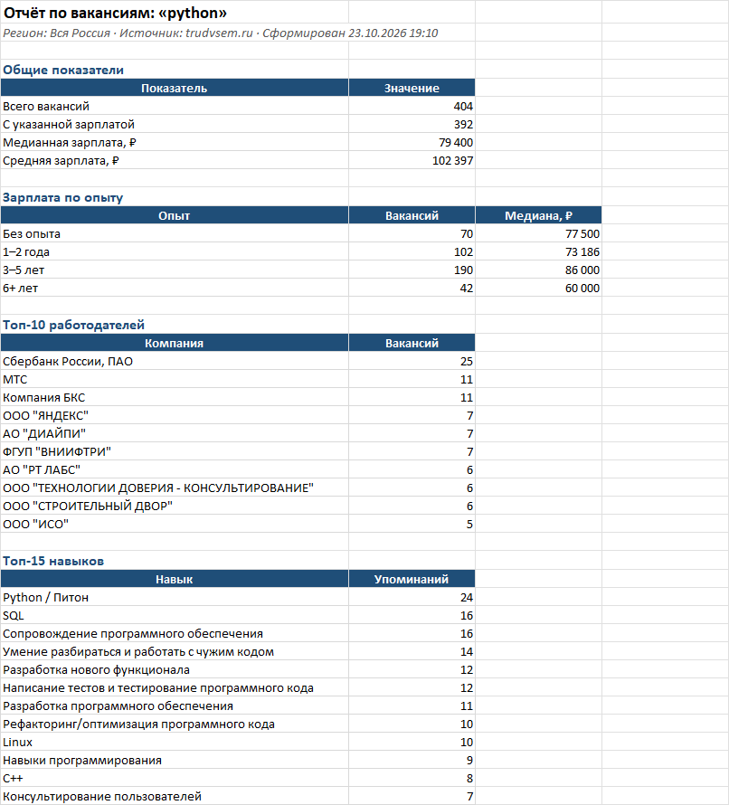
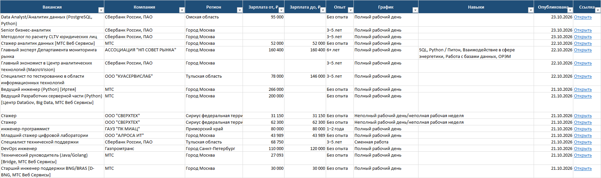

# Vacancy Parser — вакансии в Excel-отчёт за минуту

Собирает вакансии с портала «Работа России» (trudvsem.ru) по запросу и региону и строит готовый Excel-отчёт: таблица с фильтрами плюс сводка по зарплатам, работодателям и навыкам.

Задача, которую решает: вместо часа ручного копирования вакансий в таблицу — одна команда.





Пример готового отчёта: [examples/report_python_russia.xlsx](examples/report_python_russia.xlsx) (404 вакансии по запросу «python», вся Россия).

## Возможности

- Поиск по ключевым словам, фильтр по региону и минимальной зарплате
- Пагинация, пауза между запросами, повтор при сетевых ошибках и перегрузке API
- Очистка данных: дубликаты, пустые зарплаты, перевёрнутые вилки, разнобой в названиях навыков
- **Лист «Вакансии»:** закреплённая шапка, автофильтр, денежный формат, даты, кликабельные ссылки
- **Лист «Сводка»:** медиана и среднее по зарплатам, зарплата по опыту с диаграммой, топ-10 работодателей, топ-15 навыков

## Установка

```bash
git clone https://github.com/mahn1/vacancy-parser.git
cd vacancy-parser
python -m venv .venv
.venv\Scripts\activate          # Windows
# source .venv/bin/activate     # Linux / macOS
pip install -r requirements.txt
```

Нужен Python 3.11+. API-ключ не требуется.

## Запуск

```bash
python main.py --query "python"
python main.py --query "аналитик данных" --region moscow --pages 3
python main.py --query "python" --region spb --salary-from 150000 --output spb_python.xlsx
```

| Параметр | Описание | По умолчанию |
|---|---|---|
| `-q`, `--query` | поисковый запрос | обязательный |
| `-r`, `--region` | `moscow`, `spb`, `mo`, `kazan`, `ekb`, `nsk` или 13-значный код региона | вся Россия |
| `-p`, `--pages` | сколько страниц по 100 вакансий загрузить | 5 |
| `--salary-from` | оставить вакансии с зарплатой не ниже указанной, ₽ | — |
| `-o`, `--output` | путь к файлу .xlsx | `vacancies_<запрос>_<дата>.xlsx` |

## Как считаются зарплаты

- API возвращает `0`, если граница вилки не указана, — такие значения считаются пустыми.
- Если «от» больше «до», границы меняются местами.
- Для статистики у каждой вакансии берётся одно число: середина вилки, если указаны обе границы, иначе та, что есть. Вакансии без зарплаты в медиану и среднее не попадают.
- Фильтр `--salary-from` сравнивает с верхней границей вилки: вакансия «от 120 000 до 160 000» пройдёт фильтр в 150 000.

## Структура

```
├── main.py             # аргументы командной строки и запуск
├── trudvsem_client.py  # работа с API: запросы, пагинация, повторы
├── transform.py        # очистка и нормализация данных
├── excel_report.py     # сборка Excel-отчёта
└── examples/           # пример готового отчёта
```

## Стек

Python 3.11 · requests · openpyxl
